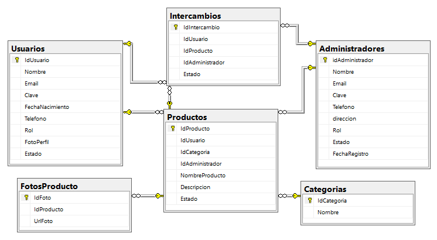

# InterApp - Proyecto Integrador 
## Sistema de Gestión de Intercambios

## Proyecto Integrador · Grupo B1 · Periodo 2026-2
Bienvenido al repositorio del **Proyecto Integrador (2026-2)**. Este sistema es una plataforma diseñada para facilitar la publicación de productos y la gestión de intercambios entre usuarios, contando además con un módulo de administración para la supervisión del sistema.

## 🚀 Descripción del Proyecto

InterApp es una aplicación web para el **intercambio de productos entre usuarios**. Los usuarios publican productos organizados por categorías, adjuntan fotos y proponen intercambios a otros usuarios. Este repositorio contiene la interfaz de gestión (CRUD) de las entidades del sistema y los scripts de base de datos.

## ✨ Características Principales

- **Gestión de Usuarios:** Registro, inicio de sesión, perfil con foto y control de estado (activo/inactivo).
  
- **Gestión de Productos:** Publicación de productos con descripción, fotos asociadas y categorización.
  
- **Sistema de Intercambios:** Solicitud y seguimiento del estado de los intercambios entre usuarios e ítems.
  
- **Módulo de Administración:** Control y auditoría por parte de administradores asignados.
  
- **Categorización:** Organización de productos por categorías dinámicas.

## 💻 Tecnologías

| Componente | Versión |
|---|---|
| Java | 25 |
| Spring Boot | 4.1.1 |
| Vaadin Flow (tema Aura) | 25.3.0 |
| Maven (wrapper incluido) | `./mvnw` |
| Base de datos | SQL Server (scripts T-SQL) |
| Contenedor | Docker (Eclipse Temurin 25) |

## 📊 Modelo Entidad-Relación (MER)

A continuación se presenta el diagrama del MER que describe las entidades y relaciones principales de la base de datos:



## 🗄️ Estructura de la Base de Datos

El MER contempla las siguientes entidades clave:

1. **Usuarios (`Usuarios`):** Almacena la información de los usuarios registrados en la plataforma (`Nombre`, `Email`, `Clave`, `FechaNacimiento`, `Telefono`, `Rol`, `FotoPerfil`, `Estado`).
   
2. **Productos (`Productos`):** Registra los productos disponibles para intercambio, enlazados con su dueño (`IdUsuario`), categoría (`IdCategoria`) y administrador responsable (`IdAdministrador`).
   
3. **Fotos de Productos (`FotosProducto`):** Soporta múltiples imágenes (`UrlFoto`) asociadas a un mismo producto.
   
4. **Categorías (`Categorias`):** Clasificación temática de los productos.
   
5. **Intercambios (`Intercambios`):** Registra las solicitudes e historial de intercambios entre usuarios y productos, supervisados por administradores.
   
6. **Administradores (`Administradores`):** Gestión y control administrativo con atributos de contacto y rol.

## 📊 Estructura del proyecto
```
├── src/main/java/com/example/
│   ├── Application.java          # Punto de entrada de Spring Boot
│   ├── MainView.java             # Vista principal con pestañas por entidad
│   └── model/                    # Clases del modelo de dominio
│       ├── Usuario.java
│       ├── Administradores.java
│       ├── Categorias.java
│       ├── Productos.java
│       ├── FotosProducto.java
│       └── Intercambios.java
├── src/main/resources/
│   ├── application.properties    # Configuración (puerto, Vaadin)
│   └── META-INF/resources/styles.css
├── interapp.sql                  # Script de la BD Interapp (tablas + datos de prueba)
├── Dockerfile
└── pom.xml
```

## 🔗 Modelo de dominio

Las clases de `com.example.model` representan las entidades del sistema:

| Clase | Atributos principales | Descripción |
|---|---|---|
| `Usuario` | idUsuarios, nombre, email, clave, fechaNacimiento, telefono, direccion, rol, estado | Persona registrada que publica e intercambia productos |
| `Administradores` | idAdministrador, nombre, email, clave, telefono, direccion, rol, estado, fechaRegistro | Usuario con permisos de administración |
| `Categorias` | idCategoria, nombreCategoria | Clasificación de los productos (p. ej. Deportes, Electrónica) |
| `Productos` | idProducto, idUsuario, nombreProducto, descripcion, idCategoria, estado | Artículo publicado por un usuario para intercambiar |
| `FotosProducto` | idFoto, idProducto, urlFoto | Imágenes asociadas a un producto |
| `Intercambios` | idIntercambio, idUsuario, idProducto, estado | Propuesta de intercambio entre usuarios |

### 🔗 Relaciones

- Un **Usuario** publica muchos **Productos**.
- Una **Categoría** agrupa muchos **Productos**.
- Un **Producto** tiene muchas **FotosProducto**.
- Un **Intercambio** relaciona usuarios y productos (en la BD: dos usuarios y dos productos).

## Base de datos

El proyecto incluye dos scripts para SQL Server:

- **`interapp.sql`** — crea la base `Interapp` con las tablas `Usuarios`, `Categorias`, `Productos`, `FotosProducto`, `Intercambios` y `Mensajes`, e inserta datos de prueba.

Para crearlas, ejecuta cada script en SQL Server Management Studio o con `sqlcmd`:

```bash
sqlcmd -S localhost -U sa -i interapp.sql
```

> La aplicación todavía no está conectada a la base de datos; los scripts se usan como referencia del modelo.

##  💻 Interfaz

La vista principal (`MainView`, ruta `/`) muestra el título **"Gestión de Roles InterApp"** y una pestaña por entidad:

**Usuarios · Administradores · Categorías · Productos · Intercambios · Fotos de Productos**

Cada pestaña tiene un formulario con los campos de la entidad, una tabla (`Grid`) y los botones **Crear**, **Consultar**, **Actualizar**, **Eliminar** y **Limpiar**. Por ahora las acciones muestran una notificación; la persistencia está pendiente.

## 📃✔ Requisitos

- JDK 25
- Git
- (Opcional) SQL Server para ejecutar los scripts
- (Opcional) Docker

No hace falta instalar Maven: el proyecto incluye el wrapper `mvnw`.

## ✅ Cómo ejecutar

Clonar la rama de trabajo:

```bash
git clone -b feature-main https://github.com/N4xtorq9/Proyecto-Integrador-b1-2026-2-GV.git
cd Proyecto-Integrador-b1-2026-2-GV
```

### Modo desarrollo

```bash
./mvnw          # Linux / macOS
mvnw.cmd        # Windows
```

También puedes abrir el proyecto en tu IDE y ejecutar la clase `Application`. La app queda en **http://localhost:8080** (el puerto se puede cambiar con la variable de entorno `PORT`).

### Build de producción

```bash
./mvnw package
java -jar target/app-1.0-SNAPSHOT.jar
```

### Docker

```bash
docker build -t interapp:latest .
docker run -p 8080:8080 interapp:latest
```

## 🌿 Ramas

| Rama | Uso |
|---|---|
| `main` | Versión estable |
| `Develop` | Integración |
| `feature-main` | Desarrollo actual del modelo y la vista |

Los commits siguen el prefijo `Chore:` con una descripción en español del cambio.

## ✅ Estado y próximos pasos

- [x] Scripts de base de datos
- [x] Clases del modelo de dominio
- [x] Vista con formularios y tablas por entidad
- [ ] Corregir errores de compilación en `MainView` y en las clases del modelo
- [ ] Conectar con SQL Server (JDBC / Spring Data JPA)
- [ ] Implementar la lógica real del CRUD
- [ ] Unificar los nombres entre las clases Java y las tablas SQL

## 👨‍💻Integrantes

- [x] Nestor Javier Quiñones Valencia
- [x] Jhonatan Perez Rayo
- [x] Juan Felipe Perez Madrid
